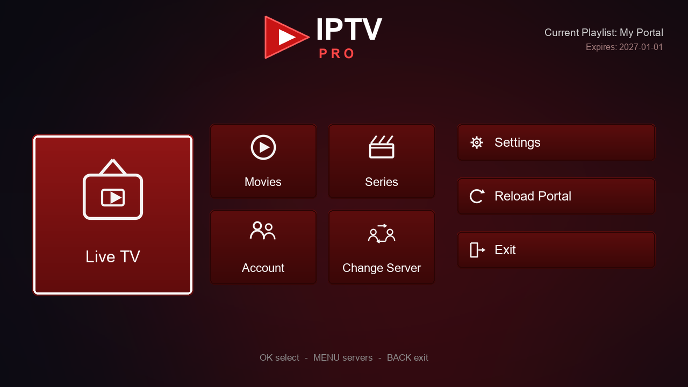

# IPTV Player Pro

بلوجين Enigma2 عربي لتشغيل قوائم **M3U** وبورتالات **MAG / Stalker**، بواجهة بلاطات (Tiles) خفيفة وسريعة، وبدون أي مكتبات خارجية على الجهاز.



## المميزات

- واجهة رئيسية ببلاطات: البث المباشر، الأفلام، المسلسلات، الحساب، تغيير السيرفر، الإعدادات، تحديث البورتال، الخروج.
- إدارة عدة مصادر (قوائم M3U وبورتالات MAG) مع تنشيط مصدر واحد في كل مرة.
- واجهة ويب محلية (WebIF) بالإنجليزية لإضافة قوائم M3U وبورتالات MAG/Stalker وتنشيطها وحذفها وتحديثها من المتصفح.
- حفظ السيرفرات في ملفات نصية قابلة للنسخ والاستيراد، مع اختيار مسار التخزين بين الذاكرة الداخلية وHDD وUSB.
- تصنيف تلقائي لقوائم M3U إلى: قنوات مباشرة، أفلام VOD، ومسلسلات مع المواسم والحلقات.
- بورتال MAG/Stalker: Handshake، بيانات الحساب، الأقسام، القنوات، الأفلام، والمسلسلات.
- مفضلة للقنوات، بحث داخل القوائم، وتحميل صفحات إضافية للأفلام والمسلسلات.
- شاشة حساب تعرض تاريخ الانتهاء وحالة الاشتراك، مع إمكانية فحص الحساب وتحديث البورتال.
- كاش محلي للقوائم لتسريع الفتح، مع صلاحية قابلة للتعديل.
- ترجمة عربية كاملة، ودعم الإنجليزية.
- يعمل على Python 2.7 (صور Enigma2 القديمة) و Python 3 (الصور الحديثة).

## التثبيت

### التثبيت السريع بسكريبت

من Telnet/SSH على الرسيفر:

```sh
wget -q --no-check-certificate -O /tmp/iptvpro.sh \
  https://raw.githubusercontent.com/azroukarim/IptvPlayerPro/main/install.sh
sh /tmp/iptvpro.sh
```

أو باستخدام curl:

```sh
curl -k -L -o /tmp/iptvpro.sh \
  https://raw.githubusercontent.com/azroukarim/IptvPlayerPro/main/install.sh
sh /tmp/iptvpro.sh
```

السكريبت يقوم تلقائيًا بتنزيل ملف `ipk` من GitHub، وتثبيته عبر `opkg`، ثم إعادة تشغيل واجهة Enigma2.

خيارات إضافية:

```sh
sh /tmp/iptvpro.sh --no-restart      # تثبيت بدون إعادة تشغيل
sh /tmp/iptvpro.sh --ipk /tmp/enigma2-plugin-extensions-iptvplayerpro_1.1.0_all.ipk
```

إذا نسخت `install.sh` وملف `ipk` إلى نفس المجلد على الرسيفر، فسيستخدم السكريبت الملف المحلي دون تنزيل.

### عبر ملف ipk

1. حمّل الملف من مجلد `dist`:
   `enigma2-plugin-extensions-iptvplayerpro_1.1.0_all.ipk`
2. انسخه إلى الجهاز، مثلًا إلى `/tmp` عبر FTP/SFTP.
3. من Telnet/SSH نفّذ:

```sh
opkg install /tmp/enigma2-plugin-extensions-iptvplayerpro_1.1.0_all.ipk
```

4. أعد تشغيل الواجهة:

```sh
init 4
sleep 2
init 3
```

أو من الريموت: **Menu → Standby & Restart → Restart GUI**.

بعد التثبيت يظهر البلوجين في: **Menu → Plugins** وفي قائمة الإضافات.

> إذا رفض `opkg` التثبيت بسبب الاعتماديات، استخدم:
> `opkg install --force-depends /tmp/enigma2-plugin-extensions-iptvplayerpro_1.1.0_all.ipk`

## الإعداد الأول

### إضافة قائمة M3U

1. افتح **IPTV Player Pro**.
2. اختر **تغيير السيرفر** (أو اضغط `MENU`).
3. اضغط الزر **الأخضر** لإضافة قائمة M3U.
4. أدخل اسمًا للقائمة، ثم رابط `m3u` أو `m3u8`.
5. يمكن إدخال User-Agent اختياري إذا كان المزوّد يتطلبه.
6. بعد الحفظ تُصبح القائمة نشطة تلقائيًا.

### إضافة بورتال MAG / Stalker

1. من شاشة السيرفرات اضغط الزر **الأزرق**.
2. أدخل اسم البورتال، ثم رابط البورتال (مثل `http://example.com:8080`).
3. أدخل عنوان MAC بصيغة `00:1A:79:12:34:56`.
4. يجب أن يكون عنوان MAC مسجّلًا ومفعّلًا عند مزوّد الخدمة.

ملاحظة: البلوجين يشتق Serial و Device ID تلقائيًا من عنوان MAC، وهذا يكفي لمعظم البورتالات. بعض البورتالات الخاصة قد تتطلب تسجيل الجهاز من طرف المزوّد.

### واجهة الويب (WebIF)

بعد تثبيت البلوجين وتشغيل Enigma2، افتح من متصفح على جهاز متصل بنفس الشبكة:

```
http://<عنوان-الرسيفر>:8099/
```

مثال: `http://192.168.1.50:8099/`

واجهة الصفحة بالإنجليزية، بينما تبقى شاشات البلوجين عربية أو إنجليزية حسب إعداد اللغة.

- تُضاف قوائم M3U وبورتالات MAG مباشرة إلى إعدادات البلوجين.
- يمكن تنشيط مصدر أو حذفه أو تحديث بياناته (سحب القائمة/البورتال) من الصفحة.
- بعد الإضافة، افتح البلوجين أو عد إلى قائمته الرئيسية لرؤية المصدر الجديد.
- الواجهة مفعّلة افتراضيًا وتعمل تلقائيًا مع بدء Enigma2.
- لتعطيلها: **الإعدادات ← تفعيل واجهة الويب ← لا**.
- لتغيير المنفذ: **الإعدادات ← منفذ واجهة الويب**.
- لمعرفة العنوان الحالي: **الإعدادات ← عنوان واجهة الويب**.

**حماية اختيارية بـ PIN:** عدّل `/etc/enigma2/iptvplayerpro/config.json` وأضف `"web_pin": "1234"` داخل كائن `settings`:

```json
"settings": {
  "web_pin": "1234"
}
```

عند فتح الصفحة سيطلب المتصفح اسم مستخدم (أي اسم) وكلمة مرور هي قيمة PIN. لا حاجة لإعادة تشغيل الواجهة بعد تعديل الملف. استخدم أرقامًا فقط لتجنب مشاكل ترميز كلمة المرور في المتصفحات القديمة.

> الواجهة تعمل بدون HTTPS. استخدمها داخل الشبكة المحلية فقط، ولا تفتح منفذها على الإنترنت.

### حفظ السيرفرات في ملفات نصية

يمكن اختيار مكان حفظ قوائم M3U وبورتالات MAC من **الإعدادات**:

- **ملف سيرفرات M3U**: `/etc/enigma2/IPTVPlayerPro/m3u.txt` أو `/media/hdd/IPTVPlayerPro/m3u.txt` أو `/media/usb/IPTVPlayerPro/m3u.txt` أو `/media/usb/m3u.txt`.
- **ملف سيرفرات MAC**: `/etc/enigma2/IPTVPlayerPro/mac.txt` أو `/media/hdd/IPTVPlayerPro/mac.txt` أو `/media/usb/IPTVPlayerPro/mac.txt` أو `/media/usb/mac.txt`.

يتم تحديث الملفين تلقائيًا عند إضافة مصدر أو تعديله أو حذفه، ويمكن تحديثهما يدويًا من **الإعدادات ← مزامنة ملفات السيرفرات الآن**. الملفان نصيان بصيغة بسيطة:

```text
# m3u.txt
# name|url|user-agent
قائمة القنوات|http://example.com/playlist.m3u8|VLC/3.0

# mac.txt
# name|portal|mac|user-agent
بورتال البيت|http://example.com:8080|00:1A:79:12:34:56|MAG254
```

يمكن تعديل الملفات يدويًا ثم اختيار **الإعدادات ← استيراد من ملفات السيرفرات** لإضافتها إلى البلوجين. الأسطر التي تبدأ بـ `#` يتم تجاهلها، ويُقبل أيضًا سطر يحتوي على الرابط فقط في ملف M3U، أو `portal|mac` في ملف MAC.

> إذا اخترت مسار HDD أو USB، تأكد من أن القرص متصل ومُركّب قبل المزامنة. عند عدم توفره لن يفشل حفظ الإعدادات، لكن الملف لن يُكتب.

## طريقة الاستخدام

- **البث المباشر**: اختر القسم ثم القناة. `OK` للتشغيل.
- **الأفلام**: اختر القسم ثم الفيلم، ثم `OK` للتشغيل من شاشة التفاصيل.
- **المسلسلات**: القسم ← المسلسل ← الموسم ← الحلقة.
- **المفضلة**: من قائمة القنوات اضغط **الأصفر** لإضافة/إزالة القناة.
- **البحث**: من قائمة القنوات أو الأفلام أو المسلسلات اضغط **الأخضر**.
- **تحديث القوائم**: الزر **الأزرق** داخل شاشات القوائم.
- **الخروج**: `BACK` أو الزر **الأحمر** حسب الشاشة.

## الإعدادات

| الإعداد | الوصف |
|---|---|
| اللغة | العربية أو الإنجليزية |
| محرك البث | `4097` GStreamer (الافتراضي)، `5001`/`5002` لـ exteplayer3، أو `1` DVB |
| مهلة HTTP | مدة انتظار الشبكة بالثواني |
| إخفاء أقسام البالغين | استبعاد الأقسام المصنفة Adult |
| إغلاق القوائم بعد التشغيل | إغلاق شاشات البلوجين بعد بدء البث |
| صلاحية الكاش | مدة استخدام القائمة المحفوظة، و`0` لتعطيل الكاش |
| ملف سيرفرات M3U | مسار حفظ ملف `m3u.txt` |
| ملف سيرفرات MAC | مسار حفظ ملف `mac.txt` |
| استيراد من ملفات السيرفرات | إضافة السيرفرات من الملفين النصيين |
| مزامنة ملفات السيرفرات الآن | إعادة كتابة الملفين بالبيانات الحالية |
| تفعيل واجهة الويب | تشغيل أو إيقاف خادم الويب المحلي |
| منفذ واجهة الويب | المنفذ الافتراضي `8099` مع بدائل جاهزة |
| عنوان واجهة الويب | عرض روابط الوصول من المتصفح وحالة الخادم |
| حذف الكاش | حذف القوائم والشعارات المؤقتة |

إذا لم يعمل البث على `4097`، جرّب `5001` أو `5002` بعد التأكد من تثبيت **exteplayer3** على الصورة.

## المسارات

| المسار | الاستخدام |
|---|---|
| `/etc/enigma2/iptvplayerpro/config.json` | إعدادات البلوجين والمصادر والمفضلة |
| `/etc/enigma2/IPTVPlayerPro/m3u.txt` | ملف سيرفرات M3U الافتراضي (قابل للتغيير) |
| `/etc/enigma2/IPTVPlayerPro/mac.txt` | ملف سيرفرات MAC الافتراضي (قابل للتغيير) |
| `/tmp/iptvplayerpro/` | كاش القوائم والشعارات والملصقات |
| `/usr/lib/enigma2/python/Plugins/Extensions/IPTVPlayerPro/` | ملفات البلوجين بعد التثبيت |

## البناء من المصدر

```sh
git clone https://github.com/azroukarim/IptvPlayerPro.git
cd IptvPlayerPro

# مرة واحدة فقط لتوليد الصور (يتطلب Pillow)
python -m pip install pillow
python tools/make_assets.py

# بناء ملف ipk
python build_ipk.py
```

سيتم إنشاء الملف في:

```
dist/enigma2-plugin-extensions-iptvplayerpro_1.1.0_all.ipk
```

### الاختبارات

```sh
python tests/test_core.py
python tests/test_web.py
python tests/test_ui_smoke.py
```

تختبر الاختبارات: تحليل M3U، التصنيف، التخزين، المفضلة، وعميل MAG عبر بورتال وهمي محلي. ويختبر `test_web.py` خادم الويب محليًا: إضافة M3U وMAG، التنشيط، الحذف، والحماية بـ PIN. كما يتحقق اختبار الواجهة من بناء جميع الشاشات باستخدام بدائل بسيطة لمكتبات Enigma2.

## هيكل المشروع

```
src/IPTVPlayerPro/
    plugin.py              نقطة دخول البلوجين
    core/                  التخزين، الشبكة، تحليل M3U، عميل MAG
    ui/                    الشاشات والواجهة
    web/                   خادم وصفحة WebIF المحلية
    images/                الصور والأيقونات
tools/                     توليد الصور ومعاينة الواجهة
tests/                     اختبارات سطح المكتب
docs/                      لقطات وصور توضيحية
build_ipk.py               بناء حزمة ipk
dist/                      الحزم الجاهزة
```

## ملاحظات وحدود

- دعم بورتالات MAG يختلف من مزوّد لآخر؛ بعض البورتالات تغيّر مسارات API أو تطلب بصمة جهاز محددة.
- لا يوجد دعم حاليًا لـ EPG أو Catch-up أو التسجيل.
- تصنيف قوائم M3U يعتمد على أسماء الأقسام والوسوم وروابط البث، وقد يحتاج بعض المزوّدين إلى تسمية أقسام واضحة.
- شعارات القنوات تُحمّل من روابط المزوّد وتُخزّن مؤقتًا؛ قد تظهر أيقونة افتراضية عند تعذر التحميل.
- البلوجين لا يجمع أي بيانات ولا يتصل بأي خدمة خارجية غير المصادر التي تضيفها أنت.

## الترخيص

MIT — انظر ملف [LICENSE](LICENSE).
